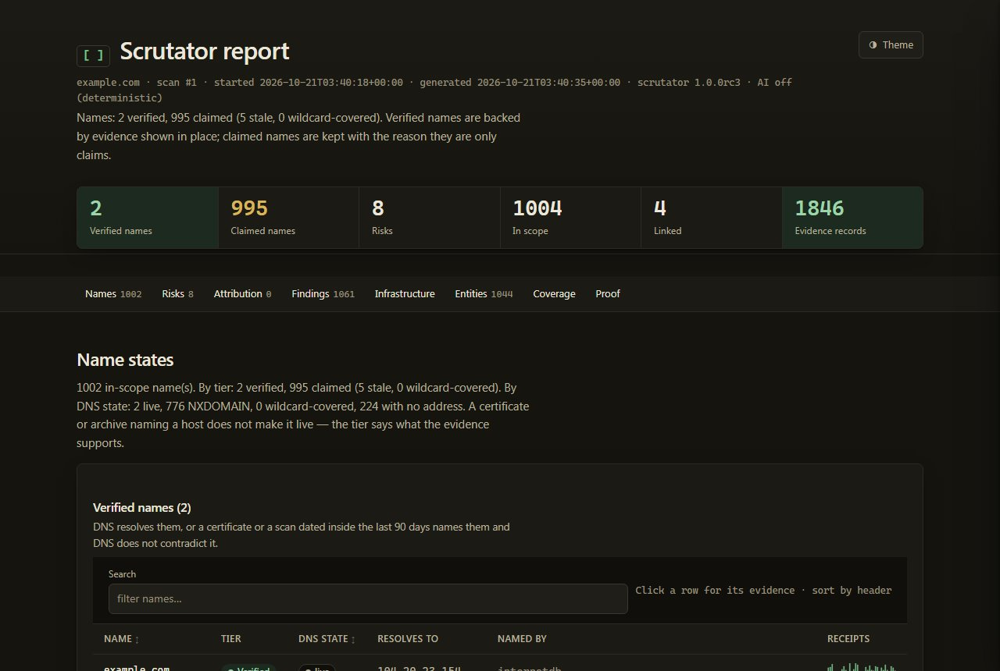
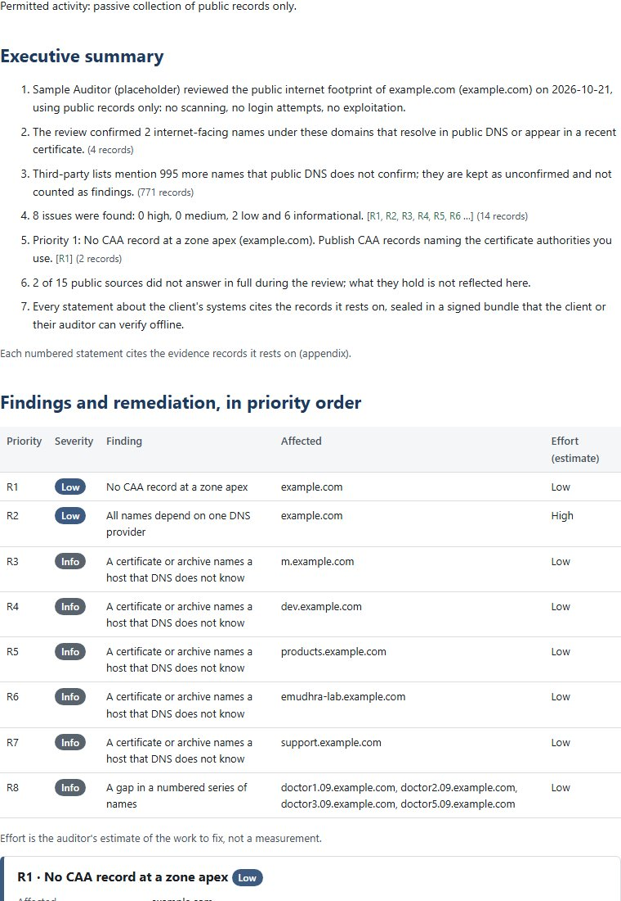

# Scrutator

[](https://github.com/cemalaysu73-star/scrutator/actions/workflows/ci.yml)
[](LICENSE)
[](pyproject.toml)

**Infrastructure OSINT where every claim has a receipt.** Point it at a domain you are allowed to assess: it asks
public sources what they know and gives you back a map of the organisation's internet-facing infrastructure in which
every finding links to the raw record it came from, and the whole report ships as a **signed proof bundle that a
stranger can verify offline**.

For penetration testers and red teamers doing recon, bug-bounty hunters, investigative journalists and OSINT
researchers, incident responders and due-diligence analysts. Passive by default: it never port-scans, never probes the
target, never brute-forces names, never looks up a person. (The few opt-in exceptions are named in
[how it works](docs/how-it-works.md#what-it-will-never-do).)



## The demo, in 20 seconds

`python demo/run_demo.py` runs offline, on a planted fixture zone, in about 30 seconds. This is an abridged copy of a
real run (nothing edited but the cuts marked `...`; [the full recording](demo/transcripts/offline.txt) is in the repo).

```
== Step 1: scan the fixture zone
   names: 17 verified, 1 claimed (4 stale, 0 wildcard-covered)
   55 entities, 73 findings, 83 evidence records, 23 risks (the zone has 22 planted issues)

== Step 2: follow a claim to its evidence
   the most severe risk: [high] CNAME to a claimable service that no longer exists
      shop.example.com is an alias (CNAME) of demo.pages.example.org, and the address lookup for shop.example.com
      returned NXDOMAIN, so the target does not exist. demo.pages.example.org matches the takeover fingerprint lab-pages.
   it cites 2 evidence record(s); the first is id c4d48be7276d6db6... (sha256 of source, request, payload):
      source   dns
      request  DNS A shop.example.com
      payload  'NXDOMAIN'

== Step 5: verify it, pinning the signer's key
$ scrutator verify proof.scrutator --pin signing.pub
PASS  file hashes
PASS  signature valid
PASS  signing key pinned
PASS  audit chain
PASS  evidence hashes
PASS  findings derivable
PASS  risks derivable
...  (19 named checks)
Verification passed.

== Step 6: tamper with it (one bit flipped inside report.json)
$ scrutator verify flipped.scrutator --pin signing.pub
FAIL  file hashes  (report.json does not match the manifest)
FAIL  report references  (1 cited evidence record(s) are not in the bundle)
FAIL  name states derivable  (the name states and tiers are not what the cited evidence implies)
Verification FAILED: do not rely on this bundle.
```

That bundle is [in the repo](docs/examples/lab-zone/) and verifies with
`scrutator verify docs/examples/lab-zone/proof.scrutator --pin docs/examples/lab-zone/signing.pub`.

## Install and first scan

```bash
pip install -e .                  # from a clone; Python 3.11 or newer; Windows, macOS, Linux (add ".[mcp]" for the MCP server)
scrutator scan example.com --bundle   # passive; writes scrutator-out/report.html, report.json, proof.scrutator
scrutator verify scrutator-out/proof.scrutator --pin ~/.config/scrutator/signing.pub
```

`scrutator keygen` creates the signing key first if you have none. Not on PyPI yet, so install from a clone. More in
the [quickstart](docs/quickstart.md).

## What makes it different

- **Tiers, not lists.** `example.com` has one live website and an aggregator lists five hundred names for it. Every
  name is *verified* (DNS resolves it, or a dated certificate names it) or only *claimed*. The headline reads
  `2 verified, 498 claimed`, not `500 subdomains`.
- **Every claim cites a record.** Findings, risks and AI statements carry the ids of the raw source answers they rest
  on, stored once and addressed by their sha256. "No such record" is evidence; a timeout never becomes a finding.
- **A report you can check.** `scrutator verify` re-derives findings, risks, name tiers and attribution from the
  bundle's own evidence and fails, naming the check, if one byte changed or a risk was quietly removed. It is built to
  be run on files from people you do not trust.
- **Scope and AI under your control.** Scope is decided by the engine, deny by default, never by a prompt. AI is
  optional, runs on a model on your machine by default, and nothing a model writes reaches the report unless a
  deterministic check and a verifier pass it.

[How it works, all of it](docs/how-it-works.md) · [Use cases with exact commands](docs/use-cases.md) · [FAQ](docs/faq.md)

## What it is not

- **Not a vulnerability scanner or a pentest tool.** It exploits nothing, tests no credentials and sends nothing to the
  target in passive mode. Its risks are configuration leads for the owner to confirm.
- **Not faster and not wider than the established recon tools.** subfinder and Amass ask more sources; knockpy
  finishes in seconds. A scan takes tens of seconds. If you want maximum enumeration, run those too.
- **Not a proof of truth or of time.** A bundle proves the report follows from the records and that nothing changed
  after signing. It does not prove the sources were right, and there is no trusted timestamp.

## Honest limits

Read these before you rely on it. They are also in [docs/security.md](docs/security.md) and
[the benchmark](docs/benchmarks/v1.0-candidate.md).

- **Passive recall is limited by what passive sources have seen.** On the one benchmark target with a real truth set
  (`zonetransfer.me`, 31 names in its published zone) Scrutator and every competitor we could run reach a small part
  of it (Scrutator 4 of 31). Names that no certificate, archive or aggregator holds are not found. The opt-in zone
  transfer (`--axfr --active`) would reach them, but it times out from the network the benchmark runs on.
- **Competitors not run.** The benchmark compares against sublist3r, knockpy and dnsrecon (which errored on every
  target). subfinder, Amass, SpiderFoot and theHarvester were **not run**, so nothing is claimed about them. Three of
  the four truth sets are pseudo-truth built from what the tools found.
- **A full scan still takes tens of seconds** (rate-limited sources, DNS, RDAP, and crt.sh's database when its web
  search is down); `knockpy` finishes in seconds because it asks fewer things. What changed in R6 is that you no longer
  wait blind: `scrutator scan` prints each name the moment DNS confirms it is live, and `scrutator quick <domain>`
  returns the verified names without the address enrichment. Measured with three interleaved runs per version
  (`bench/ttfn.py`, [docs/benchmarks/r6.md](docs/benchmarks/r6.md)): on `owasp.org` the first verified name went from
  29.2 s (only in the final report) to 7.0 s, and `quick` took 7.0 s; on `nmap.org` the first name went from 11.6 s to
  4.7 s, but `quick` took 12.7 s and the full scan got *slower* (11.6 to 18.0 s median), so speed is better felt than
  measured end to end.
- **Attribution is a lead, not a finding.** Its weights are chosen by hand and calibrated on nothing but a synthetic
  lab written by the author of the scoring.
- **A signed bundle proves integrity, not truth and not time.** There is no trusted timestamp (RFC 3161), and without
  `--pin` anyone can sign a forged bundle with their own key. If a source lied, the bundle faithfully contains the lie.
- **The AI layer is a filter, not an oracle.** A deterministic check stops invented hosts, addresses, numbers,
  alarm words, negations and copied record text even from a verifier that agrees with everything; an invention in plain
  words about a name the facts know still needs the verifier model to catch it.
- **Not tested against the real services:** the three keyed sources (VirusTotal, SecurityTrails, Shodan DNS) and the MCP
  server with Claude Desktop itself.
- **The two opt-in modules are narrow on purpose.** Brand presence knows only what a profile page's HTTP status says
  (a suspended account can look like a missing one); organisation exposure is a preview that has not had the legal
  and ethics review its design requires, and runs only when you set `SCRUTATOR_PREVIEW_EXPOSURE=1`.
- **A proxy covers HTTP, not DNS.** `SCRUTATOR_PROXY` routes the HTTP sources and the crt.sh connection through an
  HTTP or SOCKS proxy; DNS lookups still go to your system resolver. See the
  [operational-security note](docs/use-cases.md#operational-security-what-the-tool-does-on-the-network).
- **Not on PyPI, no signed releases yet.** Install from a clone; see the release notes for how to verify a release.

Benchmark numbers, exactly as measured (run `2026-10-21-r6-final`, [r6.md](docs/benchmarks/r6.md)): the frozen
criterion (recall at least the best competitor's on every truth target, every result evidence-backed, bundle
verifies) was met on all four targets: zonetransfer.me 13% against knockpy 6%; example.com and nmap.org 100%, ties;
owasp.org 97% (59 live names) against knockpy 72%. A win against sublist3r, knockpy and a dnsrecon that errored.

## For consultants and bug-bounty hunters

**Consultants, vCISOs and MSPs** who sell an external exposure review (for an ISO/IEC 27001, NIS2, KVKK/GDPR or
cyber-insurance file): `scrutator audit` turns a passive scan into a branded, print-ready deliverable in English or
Turkish, with the authorisation it rests on, a plain-language executive summary, prioritised findings with remediation,
an informational ISO 27001 / NIS2 / CIS / OWASP mapping, the asset inventory, what was **not** tested, and an evidence
appendix. Your client's auditor checks it offline, without trusting you, in three commands. It refuses to run without
a signed authorisation (`scrutator audit-letter` writes a template) or `--self` for your own domains.

```bash
scrutator audit-letter --lang tr --client "Ornek A.S." --domains ornek.com.tr --out authorisation
scrutator audit ornek.com.tr --engagement authorisation/engagement.yaml --branding audit.yaml --out audit-ornek
scrutator audit-check audit-ornek/audit.html audit-ornek/proof.scrutator      # what the client runs
```



A real sample, made from the planted lab fixture (example.com names only, a fictional client, a placeholder auditor):
[docs/examples/audit/audit.html](docs/examples/audit/audit.html) and its [PDF](docs/examples/audit/audit.pdf), the
[Turkish version](docs/examples/audit/tr/audit.html), the bundle and the signer's key next to them. Measured on the
author's machine: a passive scan plus the audit took 21 to 44 s on the benchmark targets. Docs:
[client audits](docs/audit.md), [monitoring for clients](docs/hosting.md).

**Bug-bounty hunters**: `scrutator bounty import` turns a programme's scope (HackerOne CSV, Bugcrowd JSON, a pasted
list) into a deny-by-default scope file and refuses what it cannot represent safely (`*`, `*.com`, odd schemes,
user-info URLs, private ranges, hidden characters); `scrutator bounty watch` announces, once, new in-scope verified
names, takeover candidates, certificates and open services, each with the evidence ids, and writes a ready-to-paste
report draft for every takeover candidate. Passive only: it never probes or claims anything. [docs/bounty.md](docs/bounty.md)

## Where to go

| If you want to | Read |
|---|---|
| understand the whole thing | [How it works](docs/how-it-works.md), [concepts](docs/concepts.md) |
| run a real workflow | [Use cases](docs/use-cases.md): pentest recon, bug bounty, audits, due diligence, incident response, journalism |
| know what leaves your machine, and whether it is legal and safe | [FAQ](docs/faq.md), [AI modes and privacy](docs/ai-and-privacy.md), [Responsible use](RESPONSIBLE_USE.md) |
| check a report someone sent you | [Proof bundles](docs/proof-bundles.md), [FAQ](docs/faq.md#how-do-i-verify-a-report-someone-sent-me) |
| see the evidence for the claims | [Benchmark](docs/benchmarks.md), [security model](docs/security.md), [example reports](docs/examples/README.md) |
| extend it | [Writing a module](docs/writing-a-module.md), [knowledge packs](docs/knowledge-packs.md), [CONTRIBUTING](CONTRIBUTING.md) |
| everything else | [Documentation index](docs/index.md), [CHANGELOG](CHANGELOG.md), [SECURITY](SECURITY.md) |

The rest of this file is the reference for every command and option.

## Install

```bash
pipx install scrutator            # once published; until then, from a checkout:
pip install -e .                  # Python 3.11 or newer; Windows, macOS and Linux
pip install -e ".[mcp]"           # with the MCP server
scrutator --version
scrutator scan example.com        # passive; writes scrutator-out/report.html, report.json, scrutator.db
scrutator quick example.com       # names only, in seconds: name sources and DNS, prints live names as they resolve
scrutator bench                   # the offline benchmark: no network, exits non-zero if a threshold fails
```

From a checkout for development: `pip install -e ".[dev]"` (includes the MCP SDK; without it the MCP tests skip).
The built wheel has been installed into a clean virtual environment and smoke-tested on Windows (`tools/wheel_smoke.py`);
CI does the same on Linux and Windows.

## Documentation

[Quickstart](docs/quickstart.md) · [Concepts](docs/concepts.md) · [Reading a report](docs/reading-a-report.md) ·
[Proof bundles](docs/proof-bundles.md) · [Client audits](docs/audit.md) · [Bug bounty](docs/bounty.md) · [Monitoring](docs/hosting.md) · [Sources and terms](docs/sources.md) · [AI modes and privacy](docs/ai-and-privacy.md) ·
[MCP](docs/mcp.md) · [Knowledge packs](docs/knowledge-packs.md) · [Writing a module](docs/writing-a-module.md) ·
[Security model](docs/security.md) · [Benchmark](docs/benchmarks.md) · [Demo](demo/README.md) ·
[CHANGELOG](CHANGELOG.md) · [SECURITY](SECURITY.md) · [CONTRIBUTING](CONTRIBUTING.md)

The rest of this file is the reference for every command and option.

## Reference: scanning

```bash
scrutator scan example.com
```

This writes `scrutator-out/report.html` (open it in a browser), `report.json` and
`scrutator.db`. Sources: certificate transparency (crt.sh — its web search, falling back to its public database when
the web search is down — and CertSpotter), DNS, RDAP, ASN (RIPEstat), Internet Archive, Common Crawl, passive DNS
(mnemonic) and four name aggregators (Subdomain Center, HackerTarget, urlscan.io, IP.THC.ORG); see
[Sources and their terms](#sources-and-their-terms). Scrutator also mines the records it already holds for in-scope
names written inside them (a host in an archived URL, a mail server in a TXT record), without any new request.
No API keys needed. Transient source failures are retried with backoff; any that still fail are
listed under **Source coverage** in the report, so a missing result is never mistaken for a negative one.

A scan always ends. `--deadline 600` (seconds, the default; `0` for no limit) is the time the whole
scan may take: at the deadline lookups still running are cancelled, nothing new starts, and the report
is written with what was collected and a note that it is partial. A source that times out or answers
5xx/429 three times in a row (`--breaker 3`; `0` to turn it off) is marked **down** for the rest of the
scan and not asked again; Source coverage shows it as down, so it is never mistaken for a source with
nothing to say. Sources that list every name under a domain are asked once, about the apex, not once
per discovered name. Ctrl-C also writes a (partial) report.

**Speed.** `scan` prints each name the moment DNS confirms it is live (`--live`, on by default when the output is a
terminal; the report is identical either way). Without a planner model a lookup starts the moment the thing it is
about is known (a name a fast source lists is resolved while a slow source is still waiting, and a name more sources
vouch for is resolved first), a lookup's results are written in one transaction, DNS goes through a bounded pool that
starts with the fastest of your name servers, a name that does not exist costs two queries instead of six,
registration and routing are asked **once per network** (neighbouring addresses cite that record), and a **public
address is asked of the regional registry that holds it** instead of through the rate-limited `rdap.org` redirector.
Measured numbers, including where it did not get faster, are in [docs/benchmarks/r6.md](docs/benchmarks/r6.md);
`python bench/profile_scan.py owasp.org` shows where the seconds of a scan go. For names in seconds, without the
registration and network enrichment, use `scrutator quick`.

```bash
scrutator quick example.com                             # names only, in seconds; --bundle still signs
scrutator scan example.com --deadline 300 --breaker 5   # five minutes at most; mark a source down after five failures in a row
scrutator scan example.com --no-live                    # do not stream live names (e.g. to a log)
scrutator scan example.com --deadline 0                 # no time limit
```

**Zone transfer (opt-in, active-ish).** `scan --axfr --active` asks each of the in-scope zone's own name servers once
for the whole zone (AXFR, TCP 53). Most refuse; a few publish their zone this way on purpose. Unlike every other
lookup this is a direct question to the target's own name servers, so it runs only with both flags, and `--active` is
recorded in the signed audit log before any lookup. Every outcome — the zone, a refusal, a timeout — is kept as
evidence, and a name only a transfer lists is `verified` (the zone's own server is authoritative). Use it only where
you are authorised to.

```bash
scrutator scan zonetransfer.me --axfr --active          # a zone that publishes its transfer on purpose
```

### Sources and their terms

Every keyless source is public; three optional sources need a key you hold. Their terms are theirs, not ours: read
them before relying on a source in a commercial engagement. The table of every source (what it gives, its terms in
short, whether its free tier is non-commercial, whether it can be replayed) is in [docs/sources.md](docs/sources.md),
and `scrutator sources` prints the same list with how each source fared in your last scan.

```bash
scrutator sources                                            # on or off and why, last scan's outcome
scrutator scan example.com --sources crtsh,dns,rdap          # only these
scrutator scan example.com --exclude-sources wayback,commoncrawl
scrutator scan example.com --no-noncommercial                # leave out the non-commercial free tiers
```

The policy is recorded in the report, the signed manifest and the audit log, and `verify` checks that no lookup came
from a source it forbids. Keys (`SCRUTATOR_VIRUSTOTAL_KEY`, `SCRUTATOR_SECURITYTRAILS_KEY`, `SCRUTATOR_SHODAN_KEY`)
come only from environment variables, are never stored, and are implemented against the documented APIs but **not
live-verified**. Details: [docs/sources.md](docs/sources.md).

### Scope

By default the scope is the seed domain and its subdomains. For anything else, write a
scope file:

```yaml
domains:
  - example.com
cidrs:
  - 203.0.113.0/24
asns:
  - AS64500
```

```bash
scrutator scan example.com --scope scope.yaml
```

Every discovered entity is marked `in`, `candidate`, `linked` or `out`. Out-of-scope entities are
recorded but never queried. An IP that an in-scope host resolves to is `linked`: passive lookups
about it are allowed. A `candidate` is a name outside the scope that the attribution engine found
evidence for (see below): it gets passive lookups only, until you promote it. Only your scope file
defines what may be investigated.

### Evidence

Findings cannot exist without evidence ids. Each evidence record is the raw response of a
source, stored once and addressed by hash. A finding's confidence is the number of distinct
sources that agree: one is low, two medium, three or more high. Every module call is written
to a hash-chained audit log.

Absence is evidence too. When a lookup answers "this name does not exist" (NXDOMAIN) or "this
name has no such record" (NODATA), that answer is stored like any other, and it is what a
risk about a missing record rests on. A timeout or a failed lookup is not stored as a negative:
silence is never turned into a finding.

### Names are not hosts

A certificate or an archive names a host that may have been retired years ago, and an aggregator may
list names that never resolved. So every in-scope name carries a **resolution state**, derived from the
DNS evidence the scan holds (report `names`, the "Name states" table in the HTML report, and the
`Names:` line of `scrutator scan` and `scrutator risk`):

| State | Meaning |
|---|---|
| `live` | An A or AAAA answer was recorded. |
| `stale` | The address lookup returned NXDOMAIN (the `ghost-hostname` risk flags the ones a certificate still names). |
| `wildcard` | It resolves, but only to addresses that a random label under the same zone also resolves to (a probe recorded as evidence, `wc-probe-<random>.<apex>`), so DNS does not prove the name exists. `named_by` lists who else names it: a certificate may still vouch for it. Wildcards below a delegated sub-zone are not probed. |
| `unresolved` | No address and no NXDOMAIN was recorded: the name has no address record, or the lookup did not run or failed. Never read as a negative. |

The states are re-derived from the evidence by `scrutator verify` (check `name states derivable`), so a
bundle cannot quietly relabel a stale name as live.

### Verified or only claimed (v0.7)

A long list is not a long result: example.com has one live name and an aggregator will happily list five hundred.
So every name also has a **tier**, how well the evidence supports the claim that it exists, and the number to
quote for a scan is *N verified, M claimed*, not one big count:

| Tier | Meaning |
|---|---|
| `verified` | DNS resolves it (an address, or any other record), **or** a certificate (`crtsh`, `certspotter`) or a scan of the host (`urlscan`) with a timestamp inside the last 90 days before it was collected names it and DNS does not contradict it. A wildcard answer does not count as a contradiction. |
| `claimed` | Only a list names it (an aggregator, an archive, `known_as` from InternetDB) and DNS gives no sign of it: NXDOMAIN or no answer. |
| `stale` | It was evidenced once (a certificate or scan, however old) and DNS no longer agrees, or the dated record is older than the window and DNS recorded no address. |
| `wildcard` | Only the zone's wildcard record answers for it and nothing dated vouches for it. |

Nothing is deleted: every claim stays in the evidence store, the report and the bundle, with the reason it is a
claim (`tier_reason`). What changes is what you see first. The report's `names` and `findings` lists put verified
entries first and every finding carries the tier of the name it is about (`other` for addresses and registrations);
`summary.headline` reads `N verified, M claimed (S stale, W wildcard-covered)`; `scrutator scan` prints that line
first; the HTML report shows the verified tables open and folds claimed, stale and wildcard names and findings into
counted groups that open on demand. A listing from an aggregator never vouches for a name, whatever dates its
payload carries; only certificate validity and scan time do, and only from the sources that record them.

`scrutator verify` re-derives the tiers, the tier of every finding and the headline counts from the report's own
evidence (checks `name states derivable`, `findings derivable`, `headline derivable`); bundles made before v0.7 carry
no tiers and still verify.

## Risks

```bash
scrutator risk                          # the latest scan in scrutator-out/scrutator.db
scrutator risk 3 --db other.db          # a scan by id
scrutator risk proof.scrutator          # a bundle (verified first; a forged one is refused)
scrutator risk --category analyst       # only the analyst detectors
scrutator risk --sarif risks.sarif      # also write SARIF 2.1.0
scrutator risk --fail-on high           # for CI: exit status 1 if a high risk exists
```

Deterministic rules read the stored graph and its evidence. Each risk has a rule id, a severity
(`info`, `low`, `medium`, `high`), the entities it is about, **at least one evidence id** (a risk
cannot exist without one), an explanation that says only what the cited evidence shows, a general
remediation hint, and a confidence. The HTML report has a **Risks** section where every risk expands
to its raw evidence.

| Rule | Severity | What the evidence must show |
|---|---|---|
| `dangling-cname-claimable` | high | A name is a CNAME of a host at a service whose names anyone can register (takeover fingerprint), and the address lookup returned NXDOMAIN. |
| `dangling-cname-known-service` | medium | The same, at a service known for takeovers where NXDOMAIN does not prove it can be claimed. |
| `dangling-cname` | medium | A CNAME whose address lookup returned NXDOMAIN, target unknown to the packs. |
| `spf-allows-all` / `spf-neutral-all` / `spf-softfail-all` | high / medium / low | The SPF record ends with `+all` (or `all`), `?all`, `~all`. |
| `spf-no-all`, `spf-multiple-records`, `spf-too-many-lookups` | medium | No default result; more than one `v=spf1` record; more than ten lookup terms in the record's own text (included records are not queried). |
| `dmarc-missing` | medium | A name with real MX records (a null MX does not count) and no DMARC record at `_dmarc.<name>` or a parent domain. |
| `dmarc-monitoring-only` | low | A DMARC record with `p=none`. |
| `caa-missing` | low | A zone apex whose CAA lookup returned nothing, and no parent zone has CAA. |
| `domain-expired`, `domain-expiring` | high; medium or high | The RDAP expiration is past, or within 30 days (14 days is high), measured against the time the data was **collected**, not today. |
| `exposed-risky-service` | medium (low confidence) | Shodan InternetDB lists a database, remote-desktop, file-share or cache port (Redis 6379, SMB 445, RDP 3389, ...) open on an address the in-scope names resolve to. It is Shodan's earlier scan, not a check made now. |
| `forgotten-name` | low | A name with a label such as `dev`, `staging`, `test`, `old`, `backup` that still resolves. A heuristic, low confidence. |
| `concentration-dns`, `concentration-edge` | info (low from ten names) | Every name server of every zone belongs to one provider; three or more names sit behind one CDN or host. Silent unless every host is recognised. |
| `ghost-hostname` (analyst) | info | A certificate or archive names an in-scope host and DNS says NXDOMAIN. |
| `numbering-gap` (analyst) | info | `app1`, `app2`, `app4`: a number in a series is missing. |
| `source-disagreement` (analyst) | low | RDAP and the zone list different name servers. |
| `brand-handle-unregistered` | medium or low (low confidence) | Only with `--brand`. An account the organisation's home page links to (medium), or the bare brand name on a platform it links to (low), answers as not existing on the public profile page. |
| `brand-lookalike-handle` | low (low confidence) | Only with `--brand`. A look-alike of the brand name exists on a platform the home page links to; ownership unknown. |

The **analyst** category is layer 1 of the analyst in the design: deterministic detectors for the
subtle things a reviewer skips. There is no AI in any detector. With an AI summary, risks are given to
the writer as findings, so a sentence about a risk is checked against the same evidence as everything
else, and an unsupported one lands in *Unverified leads*.

The report also holds a **dependency map**: which providers stand behind the names (DNS provider from
the name servers, mail provider from MX and SPF, CDN or host from CNAME targets and the AS behind each
address, certificate authority from currently valid certificates).

**Exit status.** `0` on success, also when risks exist. `1` when `--fail-on` is given and a risk at or
above that severity exists (and from `verify` when a check fails). `2` for usage errors: a missing
database, an unknown option value, a pack directory that fails validation.

**SARIF.** Entities are *logical* locations (a DNS name is not a file), so results have no physical
location. Uploaders that need one (GitHub code scanning does) must supply it; that belongs to a later CI
integration. Each result has a stable `partialFingerprints` entry made of the rule and the entities, so
a later run can recognise the same finding and update its ticket instead of opening a new one.

## Brand presence

Off by default. `--brand` adds one module to a scan of an organisation's domain:

```bash
scrutator scan example.com --brand
```

1. It reads `robots.txt` of the site (user agent `scrutator`; a robots.txt that cannot be read counts as "disallow
   everything") and, if allowed, the home page, one request a second, no login, at most three redirects and only inside
   the scope. From the page it keeps only the links to platforms the knowledge pack `platforms` knows.
2. For each linked platform whose public profile page tells existence by its HTTP status (GitHub, GitLab,
   mastodon.social, Hugging Face, Codeberg, Docker Hub), it asks whether the linked accounts exist, whether the bare
   brand name (the first label of the domain, never free text) is taken, and whether up to 20 look-alikes of the brand
   name exist (homoglyphs, added words, separators, keyboard typos). Status only; nothing is read from the page;
   redirects are not followed.
3. Platforms the site does not link to are never asked about. X, LinkedIn, Facebook, Instagram, TikTok, YouTube and the
   others whose terms restrict automated access, or whose page answers the same for any handle, are never requested: a
   link to them is listed as *unverifiable*. An answer that does not match the platform's rules (a redirect to a sign-in
   page, a 403, a timeout) is *unverifiable* too, never *absent*.

The result is the report's `brand` section (and a table in the HTML), and two risks: `brand-handle-unregistered` and
`brand-lookalike-handle`, both low confidence, because the status of a profile page is all the evidence there is (a
suspended account can look like a missing one; a look-alike may be the organisation's own, a fan's or an
impersonator's). The behaviour of each platform was observed live on 2026-10-20 from one network (two requests each)
and is recorded with the entry; platforms change. `verify` re-derives the section from the evidence and the
embedded pack (`brand derivable`); `verify --replay` re-asks the profile pages, never the organisation's site.

## Organisation exposure (authorised, aggregate)

Off by default, a separate command, and it refuses to run without an engagement file. It estimates how much of an
organisation's social-engineering surface its own publications give away, for an authorised red-team or defensive
assessment. It is **not** a way to look people up: a person is never a seed, and nothing is collected about anyone
outside their work address.

```yaml
# engagement.yaml
organisation: Example Corp
domains: [example.com]
authorised_by: {name: A. Person, role: CISO}
start: 2026-10-01
end: 2026-12-31
purpose: External red-team assessment of phishing exposure
github_orgs: [example]          # optional: public code organisations the organisation owns
```

It is a preview until it has had the legal and ethics review its design requires: it runs only with the environment
variable `SCRUTATOR_PREVIEW_EXPOSURE=1` set, as well as the engagement file.

```bash
scrutator exposure example.com --engagement engagement.yaml            # shows the attestation and asks to confirm
scrutator exposure example.com --engagement engagement.yaml --yes --bundle
scrutator exposure example.com --engagement engagement.yaml --detail   # per-person file, logged in the audit log
```

- **Refusals.** No engagement file, an invalid one, or one not in force today: refused before any lookup. A seed that
  is a name, an e-mail address, a phone number or a handle: refused. A domain that is not in the engagement: refused.
  The engagement (file sha256, fields, how the attestation was confirmed) is written to the hash-chained audit log
  before the first lookup, and travels in the signed bundle.
- **Sources: only what the organisation itself publishes.** Its site (robots.txt honoured: `security.txt`, the home
  page and at most three contact, about, team, imprint or legal pages it links to), its DMARC and SOA records, its RDAP
  contacts, and the public repositories of the GitHub organisations the engagement file names (commit addresses). No
  professional networks, no social profiles, no search engines. Breach counts are designed as counts only
  (`orgexposure.breach_counts`) and are not wired to any service.
- **Minimised at collection.** An address outside the engagement's domains is dropped and only counted. A role mailbox
  (`security@`, `billing@`, `hr@` ...) is kept: it names a function. Any other address is stored only as its shape
  (`word.word`, `initial.word` ...) and a pseudonym under a key that lives for one run, so the database, the report, the
  HTML and the bundle hold no personal address. Names, phone numbers and postal addresses on pages are never extracted.
- **Output is aggregate:** how many work addresses are public, role mailboxes and the functions they reveal, the
  naming pattern of person-like addresses, and what an attacker could infer (each inference cites its evidence). With
  `--detail` the person-like work addresses of this run are written to `exposure-detail.json` beside the report (never
  into the report or the bundle), and an `exposure_detail` record is added to the audit log.
- `verify` checks that the report's engagement is the one the signed audit log recorded before any lookup
  (`engagement recorded`) and re-derives the aggregate (`org exposure derivable`).

**Release status.** The design requires a legal and ethics review before this ships; it has not had one. It is a
preview, off by default; read [RESPONSIBLE_USE.md](RESPONSIBLE_USE.md) and check the law where you work (in the EU, the
GDPR applies to work addresses too) before using it on real data.

## Attribution

Some assets belong to an organisation without any name match: a sister domain, an acquired brand, a
service run under another name. Attribution looks for names **outside your scope** that the evidence
ties to the organisation, scores them, and explains every score.

```bash
scrutator scan example.com --scope scope.yaml --attribution   # mark and look at candidates, passively
scrutator candidates                                          # who may be ours, strongest first
scrutator attribution --entity partner.example.net            # why, and what could make it wrong
scrutator promote partner.example.net --scope scope.yaml      # accept it into scope (asks first)
```

**What it looks at.** Ten signals, each computed from stored evidence only. A signal that points at a
shared provider (a CDN, a mail service, a public CA, a DNS operator the packs know) is kept in the
output with weight 0 and the reason, so you can see what was ignored.

| Signal | Weight | The evidence |
|---|---|---|
| `ns_in_scope` | 0.90 | the name is delegated to a name server under an in-scope domain |
| `mx_in_scope` | 0.70 | its mail is received by a host under an in-scope domain |
| `spf_in_scope` | 0.60 | its SPF record includes a name under an in-scope domain |
| `cert_san` | 0.60 | one certificate lists both an in-scope name and this name |
| `rdap_registrant` | 0.60 | its registrant organisation is the same as an in-scope domain's |
| `shared_ns` | 0.50 | it uses the same name servers as an in-scope zone, and they are not a shared provider |
| `shared_mx` | 0.40 | it receives mail on a host an in-scope name also uses, and that host is not a shared provider |
| `network_owner` | 0.35 | its address is in a network with the same owner or AS as an in-scope address, and that is not a shared provider |
| `scope_uses` | 0.20 | an in-scope name points its name servers, mail or SPF at it, and it is not a shared provider |
| `cert_issuer` | 0.10 | it and an in-scope name use certificates from the same issuer, and that issuer is not a common CA |

A certificate with more than ten names counts for less (ten divided by the number of names: it looks
like a shared service's), and one that had been expired for over a year when it was collected counts
half. A registrant that is a redaction placeholder or a privacy service is not a registrant.

**The score and the band.** Independent signals combine as `1 - product(1 - weight)`, so no score
passes 1 and weak signals stay weak. Bands: `confirmed` (score 0.90 or more from at least two kinds of
signal), `probable` (0.70), `possible` (0.35), `unlikely`. **`probable` and `confirmed` need an
ownership signal**: `ns_in_scope`, `mx_in_scope`, `spf_in_scope` or `rdap_registrant`, evidence that
only the owner, or someone it runs services for, can produce. A shared certificate, name servers,
network or mail host can just as well be a partner's or a host's, so on their own they never get past
`possible`. The planted lab showed this rule was needed: without it a partner with a co-branded
certificate and the same small DNS operator scored 0.80.

**These weights are chosen by hand.** They are not measured and not calibrated to the real world.
The knowledge packs' `signals` file can lower a signal's weight with a measured frequency (how often
unrelated organisations show it, with the sample size); it ships empty because no such corpus has been
collected, and numbers are not invented.

**What a candidate may and may not receive.** A name enters the `candidate` state when at least one
counted signal of 0.20 or more points at it (at most `--max-candidates`, 20 by default). It then gets
passive DNS, registration and certificate lookups, once, and the network lookups for the addresses it
resolves to. Names found through a candidate are only recorded. No active module ever runs on it.
Names that nothing in the scan links to the scope cannot be found this way: finding them needs a
reverse lookup (names on this name server, names on this address), which is a keyed source and not part
of passive mode.

**Promotion is the only way in.** `scrutator promote NAME --scope scope.yaml` shows the band, score and
evidence count, asks for confirmation (`--yes` skips it), adds the name to your scope file (the old file
is kept as `scope.yaml.bak`; YAML comments are not preserved), writes a `promoted` record to the
hash-chained audit log (who asked: `cli` or `mcp`; when; the score and evidence it rested on), and only
then raises the entity to `in`. Adding a name adds everything under it, so promote the apex you mean.
Scan again to investigate it fully. Anything that is not a candidate is refused.

**What the bundle checks.** `verify` recomputes the attribution from the report's own evidence
(`attribution derivable`), so a raised band or a hidden caveat fails even when the bundle is re-signed.
It also checks that the report's promotions are exactly those in the signed audit log
(`promotions recorded`) and that every lead cites evidence that is in the bundle.

### How well does it work?

Measured on the planted lab (`src/scrutator/benchlab/attrlab.py`, run by `scrutator bench`): an organisation with 16 names of its own and a set of
decoys, answered by a fake resolver and mocked sources, no network. It is a synthetic zone written by the
author of the scoring: it shows the scoring behaves as designed on the cases its author thought of, not
how accurate it is on real organisations. The decoys are the cases the design discounts (Cloudflare name
servers, a shared hosting AS, a certificate that lists 28 names, a vendor the SPF record includes), two
cases it only partly handles (a partner with a co-branded certificate on the same small DNS operator, an
old certificate on that operator), and **one it cannot solve**: a customer whose DNS the organisation
runs, which looks exactly like the organisation's own, and is a planted false positive in the
`confirmed` band. Of the 16 true names, one is found but not believed (an old certificate and nothing
else) and one cannot be found at all.

| Band | Names | True | Precision | Precision, this band or better | Recall, this band or better |
|---|---|---|---|---|---|
| confirmed | 7 | 6 | 0.86 | 0.86 | 0.38 |
| probable | 5 | 5 | 1.00 | 0.92 | 0.69 |
| possible | 5 | 3 | 0.60 | 0.82 | 0.88 |
| unlikely | 31 | 1 | 0.03 | 0.31 | 0.94 |

The exit criterion is precision of at least 0.9 in the `probable` band on the lab: 5 of 5 in the band,
11 of 12 for `probable` or better. Five names is a small sample; read it as a regression test, not as a
rate.

## Analyst leads and the pre-mortem (AI)

Every candidate comes with a **pre-mortem** made by rules: what in the evidence could make the
attribution wrong (one kind of signal only, a certificate that may be a partner's, signals ignored as
shared providers, a name nobody has looked at yet), each citing the evidence it rests on. It needs no
model.

With a model, `scrutator scan --attribution` also asks the planner role for up to eight **leads**
(something odd the evidence shows) and **pre-mortems** (what could make an attribution wrong). The model
sees entities and evidence as short references (`N1`, `E3`), never real ids, inside fenced data blocks,
and can only cite what was listed to it: an item with an unknown reference, a pre-mortem about something
that is not a candidate, or a suggested check that is not a registered passive module on a listed
entity is discarded before anyone reads it. What is left goes to the verifier role, like the summary
statements: unsupported items are kept as *Unverified leads*, never in the report proper, and with no
verifier nothing is published. A suggested check is shown, never run. Without a model, or when it fails,
the rules' pre-mortem stands alone.

## Knowledge packs

Everything the tool knows about the world that is not code is in versioned YAML packs shipped inside
the package: provider fingerprints (name server, mail, CDN, hosting and certificate-authority patterns,
and AS numbers), takeover fingerprints, a schema for attribution-signal frequencies (empty until there is
a measured corpus), and **playbooks**.

```bash
scrutator packs list                    # the files in use, versions, entry counts
scrutator packs validate                # schema and manifest check of the bundled packs
scrutator packs validate my-packs/      # the same for your directory
scrutator scan example.com --packs my-packs/   # extend or override the bundled data
scrutator risk 3 --packs my-packs/      # re-evaluate an old scan with newer knowledge
```

**Adding a provider is one data entry, no code.** Drop a file like this into a directory and pass it
with `--packs`:

```yaml
schema: 1
kind: providers
version: 2026.10.1
updated: 2026-10-16
entries:
  - id: acme-dns
    provider: Acme DNS
    category: dns            # dns | mail | cdn | hosting | ca
    ns: [dns.acme.example]   # host suffixes; a label may contain *; mx, spf, cname, asn, issuer for other categories
    examples: [ns1.dns.acme.example]   # values this entry must match: a fixture the validator can run
    source: "https://docs.acme.example/nameservers"
    verified: false          # true once you checked the patterns against the source
```

An entry with the same `id` as a bundled one replaces it. The packs a scan used are recorded with it
and travel inside its proof bundle, so a report is always read with the knowledge it was made with.
The same entry also decides attribution: a name server operator listed here is a shared provider, and
signals that point at it stop counting.

**Playbooks** are short recipes for the agent: a title, the situations in which it applies (an alias
points outside the scope, a certificate names an outside host, a name receives mail, a zone is
delegated, an address has no network yet, candidates are waiting, an SPF record names other senders),
the steps, and the modules the steps are about. Which situations hold is decided from the graph alone.
When the planner has more lookups than steps and a model is running, the (at most three) playbooks that
fit are put in its prompt as curated guidance outside the data fence; they can change the order it
chooses in, never the options, and the scope stays whatever your file says. `--no-playbooks` turns them
off, and the audit log records which playbooks each round was offered. Playbooks are loaded and
validated like the other packs but are not part of the hash a proof depends on, because no derived
result depends on them. The bundled ones are procedures written for Scrutator, all marked `verified:
false`: their `source` is background reading.

### Do playbooks help?

A deterministic harness (`tests/ablation.py`) runs the agent on the planted lab with a stand-in planner
that obeys guidance the way a model asked to would, once with the playbooks in its prompt and once
without, at four lookup budgets:

| Lookup budget | Names resolved, without | Names resolved, with | Risks found, without | Risks found, with |
|---|---|---|---|---|
| 8 | 5 | 6 | 2 | 2 |
| 10 | 7 | 8 | 3 | 3 |
| 14 | 8 | 8 | 3 | 3 |
| 24 | 8 | 8 | 3 | 3 |

(v0.5 published 1, 1, 4 and 8 names without playbooks. In v0.6 the sources that list every name under a
domain run once per apex instead of once per name, so the unguided agent wastes far fewer lookups and the
guidance has less to win back.) This shows that retrieval reaches the prompt and changes what the agent
does with a tight budget, and that with room to spare both finish the same investigation. It does **not** show that a real model
benefits: the stand-in obeys by construction. The real-model ablation is part of the v1.0 benchmark.

To change the bundled packs: edit the YAML in `src/scrutator/packs/data`, run `scrutator packs manifest
src/scrutator/packs/data` to refresh the sha256 manifest, run `pytest`, and open a pull request.

**Where the bundled data comes from.** Takeover entries come only from the community project
[can-i-take-over-xyz](https://github.com/EdOverflow/can-i-take-over-xyz) (a service is listed only if its
`fingerprints.json` gives a CNAME pattern and rates it Vulnerable or Edge case). Provider entries marked
`verified: true` were checked against the vendor documentation named in their `source`; those marked
`verified: false` are widely known patterns that have not been re-checked yet, and the dependency map
says so. Each entry carries `examples` that the test suite runs against the entry itself.

## Proof bundles

A scan can be exported as a signed bundle that anyone can check without trusting you or this tool's output.

```bash
scrutator keygen                      # once: creates ~/.config/scrutator/signing.key and signing.pub
scrutator scan example.com --bundle   # also writes <out>/proof.scrutator
scrutator export 3 --bundle proof.scrutator   # or export any scan in the database
scrutator verify proof.scrutator --pin <fingerprint-or-signing.pub>
scrutator verify proof.scrutator --pin signing.pub --replay
```

A bundle holds `report.json`, every raw evidence record (`evidence.jsonl`), the hash-chained audit
log (`audit.jsonl`) and a signed manifest. `verify` checks each layer on its own: file hashes, the
Ed25519 signature, the audit chain, that every evidence record hashes to its id, that everything the
report cites is in the bundle, that the report's findings are exactly what the evidence implies, and
that its **risks and its attribution are exactly what the evidence and the embedded packs imply**
(`risks derivable`, `attribution derivable`): both engines are pure functions of the report, so `verify`
recomputes them. The manifest records the packs used; `packs intact` checks them against this tool's own
copy of the bundled packs, so removing a takeover fingerprint and recomputing every result is still
caught. Pack entries you added yourself cannot be checked against a trusted copy; `verify` says so, and
the signer is vouching for them. Change one byte anywhere and a named check fails. Bundles made by
older versions still verify; the checks that did not exist then are reported as not applicable.

**A valid signature only proves the bundle matches the key inside it.** Anyone can sign a forged
bundle with their own key, so give readers your key fingerprint through a channel they trust and
have them verify with `--pin`. Without `--pin`, `verify` warns.

`--replay` re-issues the recorded requests (HTTPS GETs to the public sources the modules use, and DNS
lookups of types A, AAAA, CNAME, MX, NS, TXT and CAA) and reports each as unchanged, changed or
unavailable. A recorded NXDOMAIN or NODATA replays as unchanged while it still holds. Drift is not
forgery: sources change and go down. Replay only ever contacts that fixed set of source hosts, so a
hostile bundle cannot make `verify` fetch arbitrary URLs.

### Compare and monitor

```bash
scrutator diff 1 2                         # two scans in the database
scrutator diff old.scrutator new.scrutator # two verified bundles
scrutator watch example.com --every 6h --webhook https://hooks.example.test/x
```

`watch` re-scans on a schedule, prints what changed, writes `diff-<n>.json`, and posts a summary
(counts and changes, no raw evidence) to the webhook. Webhooks must be HTTPS (plain HTTP only for
localhost). Watch scans are deterministic. On top of the diff, each run turns what is new into severity-ranked
alerts, announced once per client folder (`--out`), each with its evidence ids and a "why this matters" line (reworded
by a model only with `--ai`, and only when verified), a weekly digest (`digest-<year>-W<week>.md`), `--min-severity`,
and `--email-to` with the SMTP server and credentials from `SCRUTATOR_SMTP_*` variables only. Running it as a
scheduled task, a systemd timer or a Docker Compose service: [docs/hosting.md](docs/hosting.md).

## AI

```bash
scrutator scan example.com             # --ai auto: uses a local model if one is running
scrutator scan example.com --ai off    # deterministic, no model
scrutator ai doctor                    # measure the configured models
```

`--ai auto` looks for Ollama, LM Studio or a llama.cpp server on this machine. If none is found
it runs without AI. **It never falls back to a cloud model on its own.**

What the models do:

- **Planner**: when there are more lookups than the step budget (`--max-steps`), it ranks the
  numbered options, guided by the playbooks that fit. It can only choose from the list it is given; if
  it fails, the first options run. It also keeps a log of hypotheses, settled only with real evidence,
  and proposes the leads described above.
- **Writer**: drafts a short summary, each statement citing findings (risks included).
- **Verifier**: checks each statement and each lead against the evidence it cites. Unsupported or
  unverifiable ones go to *Unverified leads* and never into the report. With no verifier, nothing is
  published.

Collected text is passed to models inside fenced data blocks marked untrusted, and model output
is validated against a schema, with repair attempts and a deterministic fallback.

### Configuration

`~/.config/scrutator/config.toml` (or `--config`):

```toml
[ai]
mode = "auto"        # auto | off | local | cloud | hybrid
redact = false
max_steps = 1000

[ai.planner]
provider = "ollama"  # ollama | openai (any OpenAI-compatible server) | anthropic
model = "qwen3:8b"

[ai.verifier]        # use a different model from the writer for independence
provider = "ollama"
model = "llama3.2"
```

### Cloud models

Cloud use needs an explicit mode or config, an API key in an environment variable named by
`api_key_env` (never written to reports), and your consent at a prompt (`--yes-cloud` skips it).
Every request that leaves the machine is recorded in the report's `egress` list (provider, model,
role, size, sha256 of the payload). `--redact` replaces apex domains, IPs and organisation names
with stable pseudonyms in outgoing prompts and restores them in the answers. In `local` mode any
non-loopback endpoint is refused.

```toml
[ai.planner]
provider = "anthropic"
model = "claude-sonnet-5-5"
api_key_env = "ANTHROPIC_API_KEY"
```

## MCP server

`scrutator mcp` serves Scrutator to an MCP client such as Claude Desktop over stdio, using the official
[MCP Python SDK](https://github.com/modelcontextprotocol/python-sdk) (`pip install "scrutator[mcp]"`).

```bash
scrutator mcp --db scrutator-out/scrutator.db                      # read-only tools only
scrutator mcp --db scrutator-out/scrutator.db --scope scope.yaml --allow-scan
scrutator mcp --db scrutator-out/scrutator.db --scope scope.yaml --allow-promote
```

| Tool | Offered | What it does |
|---|---|---|
| `list_candidates` | always | names outside the scope that may be ours, with band and score |
| `attribution` | always | every signal and its evidence, and what could make it wrong |
| `risk` | always | configuration risks of a scan, each citing evidence |
| `verify_bundle` | always | the checks of `scrutator verify` for a `.scrutator` file |
| `scan` | `--allow-scan` | a passive scan of a seed inside your scope file; a seed outside it is refused before anything is looked up; no AI, no active modules |
| `promote_candidate` | `--allow-promote` | accept a candidate into scope; changes nothing unless called with `confirm=true` |

A Claude Desktop entry (adapt the paths; use the full path to `scrutator` if it is not on `PATH`):

```json
{
  "mcpServers": {
    "scrutator": {
      "command": "scrutator",
      "args": ["mcp", "--db", "C:\\scans\\scrutator.db", "--scope", "C:\\scans\\scope.yaml", "--allow-scan"]
    }
  }
}
```

What is checked, and what is not. The test suite starts the server as a real subprocess and speaks to it
in raw JSON-RPC frames over stdio: the handshake, the tool list, every tool, refusals, and that stdout
carries nothing but protocol frames. It has **not** been run against Claude Desktop itself; the roadmap
criterion "Claude Desktop drives a scan via MCP" needs a manual run. Results contain names and text from
the investigated organisation's public records, so each result says they are untrusted data; a client
that shows you every tool call before it runs is also the human in the loop for `promote_candidate`,
which Scrutator cannot check. The server never offers `scan` or `promote_candidate` unless you started it
with the flag, and the scope file is the only thing that decides what a scan may touch.

## Checking it against a real domain

`example.com` is reserved for documentation, so it is a safe target, and everything below is passive.
Run this yourself; the commands need network access and, for the bundle, a signing key. A scan with
attribution can take several minutes when crt.sh or the archives are slow.

```bash
scrutator keygen
scrutator scan example.com --out live05 --ai off --attribution --bundle
scrutator risk --db live05/scrutator.db
scrutator candidates --db live05/scrutator.db --min-band unlikely
scrutator attribution --db live05/scrutator.db --min-band unlikely
scrutator verify live05/proof.scrutator --pin ~/.config/scrutator/signing.pub --replay
scrutator packs validate
```

What to look for, and what the design predicts for example.com at the time of writing (your run is the
test, not this paragraph):

- `risk` lists only risks whose evidence it can show; open the HTML report and expand a few. The name
  servers are Cloudflare's, so expect `concentration-dns` (info). The null MX record (`0 .`) means
  "no mail", so there must be **no** `dmarc-missing`. The SPF record is `-all`, so there must be no SPF risk.
- Old certificates in the CT logs name hosts such as `dev`, `m`, `products` and `support` that DNS no
  longer knows, so expect four `ghost-hostname` findings (info, analyst), each citing a stored `DNS A
  <host>` record whose payload is `NXDOMAIN`. Cloudflare-hosted zones such as example.com do not send a
  real NXDOMAIN for a missing name: they answer NOERROR with an NSEC record whose type bitmap lists
  `NXNAME` ("compact denial of existence"), and only to a query that asks for DNSSEC records. Scrutator
  sets the DO bit and treats that answer as `nxdomain`; an NSEC without `NXNAME` stays `nodata`, which is
  why the apex CAA lookup is still `NODATA` and `caa-missing` appears if the apex has no CAA record.
- `candidates` should list **nothing** at `possible` or better. The only name outside the scope that
  shares a certificate with example.com is `m.testexample.com`, on a certificate that expired in 2017:
  expect it as `unlikely`, score 0.30 (`cert_san` halved for age), marked `candidate`, and a pre-mortem
  that says one kind of evidence supports it. After its one passive look nothing else ties it to
  example.com: its name servers are not example.com's. The Cloudflare name servers example.com
  uses are a shared provider, so they are not candidates at all. A name that appears here as `probable`
  or better is a bug: open the evidence it cites.
- `verify` should pass every check, including `risks derivable`, `attribution derivable`, `promotions
  recorded` and `packs intact`. With `--replay` the NXDOMAIN, NODATA and CAA records should replay as
  `unchanged`, and `skipped` should be 0.
- Any risk or candidate that looks wrong is a bug: open the evidence it cites, and file an issue with the
  evidence id.

## Responsible use

Passive mode only queries third-party public sources, but those services see what you search
for, and cloud AI sees summaries of what was found. Only investigate organisations you are
authorised to assess or that you are entitled to research. Scrutator never searches for a
named private individual. Risk findings describe configuration visible in public DNS and
certificate records; they are leads for the owner to confirm, not proof of compromise. Attribution is
a set of leads with scores: a `candidate` is not yours until you say so, and nothing is investigated
beyond passive lookups before then. Takeover confirmation by an active check is not part of passive mode. The two
opt-in modules (`--brand`, `scrutator exposure`) and what they may be used for: [RESPONSIBLE_USE.md](RESPONSIBLE_USE.md).

## Develop

```bash
pip install -e ".[dev]"
python -m pytest -q -p no:cacheprovider    # no network; about 4 minutes
scrutator bench --out scrutator-bench       # OSINT-Bench v0, offline
python bench/run_bench.py                   # the live competitor benchmark (network)
```

Licence: Apache-2.0 (see `LICENSE`). Contributing: [CONTRIBUTING.md](CONTRIBUTING.md). Security: [SECURITY.md](SECURITY.md).
