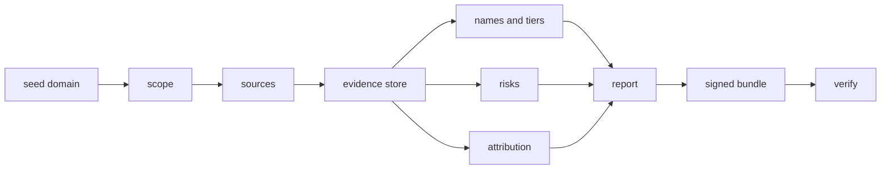
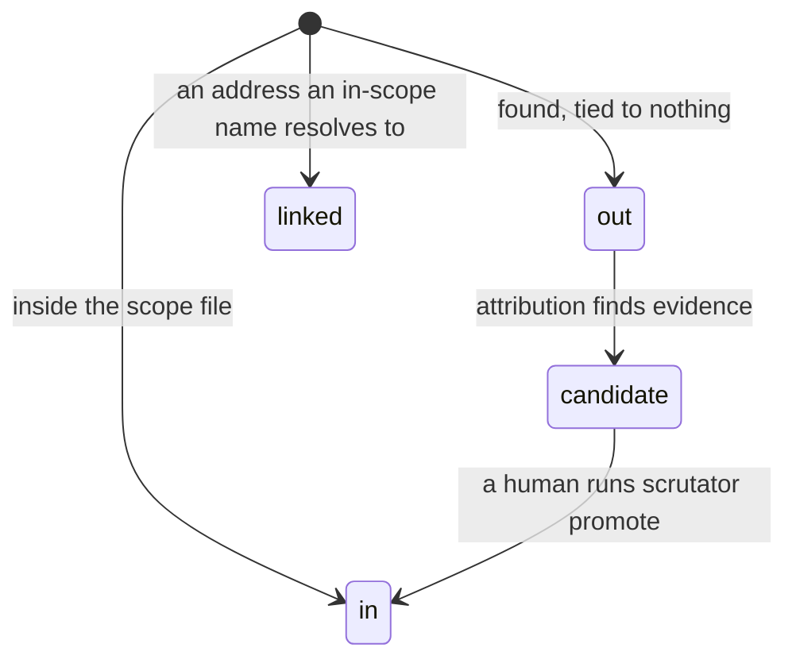
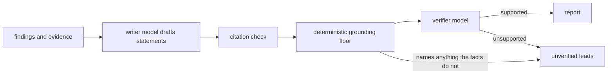

# How Scrutator works

This page explains the whole tool, in order, for people who will rely on its output: penetration testers and red
teamers doing recon before an engagement, bug-bounty hunters, investigative journalists and OSINT researchers, incident
responders and due-diligence analysts. It says what each stage does, what it will not do, and where the guarantees
end. Nothing here is marketing: where a stage is weak, it says so.

## The idea in one paragraph

A recon tool normally prints a list of names. Scrutator prints a list of names **and keeps the raw answer of every
source that contributed to it**, addressed by its hash. Every statement it makes (a name is live, a CNAME dangles,
this domain probably belongs to the same organisation) lists the ids of the records it rests on. The whole report can
be shipped as one signed file, a *proof bundle*, and a stranger can check offline that the report follows from the
records and that nothing was changed after signing. You do not have to trust the author or the tool's printed output.

## The pipeline



Every box is deterministic code except the optional AI layer, which sits beside the pipeline and can only propose
(see [Local-first AI](#local-first-ai-and-what-never-leaves-your-machine)).

1. **Seed.** One domain you are allowed to assess, or a scope file listing several domains, address ranges and AS
   numbers.
2. **Scope.** The engine, not a prompt, decides what may be looked up. Deny by default (next section).
3. **Sources.** Public services are asked what they know about the in-scope names: certificate transparency (crt.sh,
   CertSpotter), your DNS resolver, RDAP registration data, the Internet Archive, Common Crawl, passive-DNS and
   aggregator services. [All of them, with their terms](sources.md). Each request goes through an egress guard that
   only allows the fixed list of source hosts.
4. **Evidence.** Each raw answer is stored once as an evidence record: `source`, `request`, `payload`, a time, and an
   id that is the sha256 of the first three. A failed lookup or a timeout is recorded as a source failure and is never
   turned into a negative. "This name does not exist" (NXDOMAIN) is real evidence and is stored as such.
5. **Names and tiers.** Every name gets a resolution state from the DNS evidence (`live`, `stale`, `wildcard`,
   `unresolved`) and a tier that says how well the evidence supports "this name exists": `verified` or only
   `claimed`. The headline is *N verified, M claimed*, not "500 subdomains".
6. **Risks.** Deterministic rules plus the [knowledge packs](knowledge-packs.md) (provider fingerprints, takeover
   fingerprints) turn evidence into configuration risks: a dangling CNAME at a claimable service, a weak SPF record,
   a missing CAA record, a forgotten staging host. Each risk cites its evidence.
7. **Attribution.** Optionally, names *outside* your scope that the evidence ties to the organisation (a sister
   domain, an acquired brand) are scored with the reasons and a pre-mortem of what could make the score wrong.
   Candidates are leads; only a human promotes one into scope.
8. **Report.** One self-contained HTML file (works offline; click a name, risk or finding to see the raw records and
   their hashes), the same data as JSON, and SARIF for risks if you ask for it.
9. **Signed bundle.** A zip of five members: the report, every evidence record, the hash-chained audit log, a manifest
   with the sha256 of each file, and an Ed25519 signature over the manifest.
10. **Verify.** `scrutator verify` runs nineteen named checks, including re-deriving the findings, risks, name tiers
    and attribution from the bundle's own evidence.

## Scope: deny by default

Scope is decided by the engine, never by a model and never by what a source returns. Every discovered entity is in
one of four states:



| State | May be looked up? |
|---|---|
| `in` | yes, all enabled passive lookups |
| `linked` | an address an in-scope name resolves to: network owner and ports as a public index saw them |
| `candidate` | one round of passive DNS, registration and certificate lookups, nothing more, until you promote it |
| `out` | never. It is recorded so you can see it, and no module runs on it |

A CNAME that points outside the scope, a host a certificate names, a name an aggregator lists: all `out` unless
attribution selects them as candidates. The scope-safety section of `scrutator bench` counts what a lab scan actually
asked: 523 DNS questions and 273 HTTP requests, none outside the scope. That is a lab, not a proof about the world, but
the same rule is enforced in code and tested with hostile inputs ([security model](security.md)).

## What "evidence-backed" and "verifiable" mean: a worked example

Take the most severe risk Scrutator reports on its planted lab zone (the fixture used by `python demo/run_demo.py`;
the files are in [docs/examples/lab-zone](examples/lab-zone/)):

> **[high] CNAME to a claimable service that no longer exists.** `shop.example.com` is an alias (CNAME) of
> `demo.pages.example.org`, and the address lookup for `shop.example.com` returned NXDOMAIN, so the target does not
> exist. `demo.pages.example.org` matches the takeover fingerprint `lab-pages`.

**Evidence-backed** means the sentence is not free text. The risk object lists two evidence ids. One of them is:

```json
{
  "id": "c4d48be7276d6db6a9820b2c468a7a21e4221da00c3b8d35d5ccf2bddc711b9b",
  "source": "dns",
  "request": "DNS A shop.example.com",
  "payload": "NXDOMAIN",
  "collected_at": "2026-10-20T20:16:36+00:00"
}
```

The id is `sha256("dns\nDNS A shop.example.com\nNXDOMAIN")`. You can recompute it without Scrutator:

```bash
python -c "import hashlib; print(hashlib.sha256(b'dns\nDNS A shop.example.com\nNXDOMAIN').hexdigest())"
```

and get exactly the id above. Change one character of the payload and the id no longer matches, so the record cannot be
quietly edited. In the HTML report the same record opens in a drawer when you click the risk.

**Verifiable** means a third party can check the whole report. The bundle contains every record and an audit log in
which each entry holds the hash of the previous one. `scrutator verify` then checks, among nineteen things:

- the three data files hash to what the manifest says, and the manifest's signature is valid;
- the audit log's hash chain is intact (nothing removed or reordered);
- every evidence record hashes to its id, and everything the report cites exists in the bundle;
- the findings, the risks, the name tiers and the attribution are **exactly what the evidence implies**: the engines
  are pure functions of the evidence, so `verify` recomputes them. Hiding a risk and re-signing the bundle fails
  `risks derivable`.

```bash
scrutator verify docs/examples/lab-zone/proof.scrutator --pin docs/examples/lab-zone/signing.pub
```

`--pin` matters. A signature alone proves only that the bundle matches the key inside it, and anyone can sign a forged
bundle with their own key. Give readers your key's fingerprint over a channel they trust and have them pin it.

### What a valid bundle does not prove

- **Not truth.** It proves the report follows from the evidence, not that the evidence is true. If crt.sh or a DNS
  server lied, the bundle contains the lie faithfully. `verify --replay` re-asks the sources, and drift is
  information, not failure.
- **Not time.** There is no trusted timestamp (RFC 3161). `collected_at` comes from the clock of the machine that
  made the bundle, and a signer can back-date. If the date matters, timestamp the bundle yourself with an external
  service.
- **Not the signer's honesty about what they chose to scan.** A bundle shows what was collected; it cannot show what
  was left out of the scope file, other than that the scope file is recorded in it.

Details: [proof bundles](proof-bundles.md), [security model and known limits](security.md).

## How it differs from subfinder, Amass and SpiderFoot

Honestly: they are faster and broader. subfinder and Amass query more sources, Amass does active enumeration and
graph building, SpiderFoot has a large module catalogue and a web UI. Scrutator has fewer sources, a tens-of-seconds
scan, and a recall problem on names that no passive source holds.

What Scrutator does that those tools do not claim to do:

| | Typical recon tool | Scrutator |
|---|---|---|
| Output | a list of names | names with a tier (verified or claimed), risks, attribution, each citing records |
| Raw source answers | usually discarded | stored, hashed, shipped in the bundle |
| A name an aggregator lists but DNS never saw | listed like any other | `claimed`, kept apart in the headline |
| Re-checking a result | run the tool again and hope | `verify` re-derives it offline; `--replay` re-asks the sources |
| Passing a result to someone who does not trust you | a screenshot or a text file | a signed file that fails if one byte changes |
| Scope | a flag or a convention | decided by the engine, deny by default, tested |

The benchmark compares Scrutator with the tools that could be run: `sublist3r` 1.0, `knockpy` 9.0.0 and `dnsrecon`
0.10.1 (which errored on every target because crt.sh answered HTTP 502). **subfinder, Amass, SpiderFoot and
theHarvester were not run**, because installing them needed an executable or a repository download that needed a
person's approval, so there is no claim about them. The numbers, from
[docs/benchmarks/r6.md](benchmarks/r6.md) (run `2026-10-21-r6-final`, Scrutator 1.0.0rc2):

| Target | Truth | Scrutator | Best competitor run |
|---|---|---|---|
| zonetransfer.me | 31 zone names | 13% (4 live) | knockpy 6% |
| example.com | 1 live name | 100% | sublist3r, knockpy 100% (tie) |
| nmap.org | 4 live names | 100% | knockpy 100% (tie) |
| owasp.org | 61 live names (union of tools) | 97% (59 live) | knockpy 72% (44) |

Read them with the limits attached: three of the four truth sets are pseudo-truth built from what the tools found,
the one real truth set (`zonetransfer.me`) is at 13%, and the full scan is not reliably faster than before and is
slower than knockpy. If you need the widest possible enumeration, use the established tools **and** Scrutator: run
theirs, then feed what you care about to Scrutator to get the evidence and the signed result.

## Local-first AI, and what never leaves your machine

Scrutator works without any model (`--ai off`). With one, a model adds three things: a planner that ranks lookups when
there are more than the step budget allows, a verified summary, and analyst leads. The rule is that **a model may
propose and never decide**.



- `--ai auto` (the default) uses a model server **on your machine** (Ollama, LM Studio, llama.cpp) if one is running,
  and runs without AI otherwise. **It never falls back to a cloud model on its own.**
- `--ai local` refuses any endpoint that is not loopback. `--ai cloud` needs an explicit mode and a consent prompt,
  and records every outgoing request (provider, model, role, size, payload hash) in the report.
- Text from sources is passed to a model only inside fenced blocks marked untrusted. Before the verifier sees a
  statement, a deterministic floor rejects any host, address, CVE id, date or number the cited findings do not
  contain, any alarm word or negation they do not carry, and any repeated prose from a raw record. A planted
  instruction in a TXT record cannot add a fact.
- What the floor cannot catch is an invention in plain words about a name the facts do know ("www.example.com serves a
  legacy application"). Only the verifier model stands in front of that class, and `scrutator bench` measures it:
  the Hallucination Test lets one such statement through with an obedient verifier. Run `scrutator ai doctor` on the
  models you use, and for important work read the evidence behind each sentence.

**What leaves your machine, in every mode:** the sources are asked about your target. Each module sends the services in
[sources](sources.md) the domain or address it looks up. In `off`, `local` and `auto` with a local server, nothing
from the AI layer leaves the machine, and nothing about what you *found* is sent anywhere. Only `cloud` and `hybrid`
send prompts (findings, evidence excerpts, names), and `--redact` pseudonymises apex domains, addresses and
organisation names in them. More in [AI modes and privacy](ai-and-privacy.md).

## What it will never do

- **Look up a person.** The seed is a domain. There is no person search, no social-media harvesting, no breach
  lookup. The opt-in organisation-exposure module reduces any person-like address it meets to a shape and a pseudonym
  before storage, refuses a person as a seed, and needs an engagement file.
- **Exploit anything.** No exploits, no credential testing, no payload delivery, no vulnerability scanning.
- **Probe in passive mode.** Passive means it asks public sources and your DNS resolver. It sends nothing to the
  target's servers. (The DNS questions are the exception worth knowing: your resolver asks the target's authoritative
  name servers when it has no cached answer, as any lookup of the name does.)
- **Do anything active by default.** The activity that is not purely passive is opt-in, per scan, recorded in the
  signed audit log before any lookup, and meant only for targets you are authorised to test: `scan --axfr --active` (a
  zone-transfer request to the zone's own name servers), authorised active confirmation of passive findings
  (`scrutator audit --active`, which needs an authorisation that covers active testing; see docs/active.md) and the two
  narrow opt-in modules `scan --brand` and `scrutator exposure`. `scrutator audit` refuses to run without a signed
  authorisation or `--self`.
- **Ask a service its terms forbid.** A source whose terms forbid automated use, or that needs scraping, is not added.

Responsible use and what to do when you are unsure: [RESPONSIBLE_USE.md](../RESPONSIBLE_USE.md).

## Where to go next

- Try it: [quickstart](quickstart.md) and the [demo](../demo/README.md).
- Concrete workflows with exact commands: [use cases](use-cases.md).
- Questions about legality, safety, privacy and verifying someone else's report: [FAQ](faq.md).
- The data model in detail: [concepts](concepts.md).
